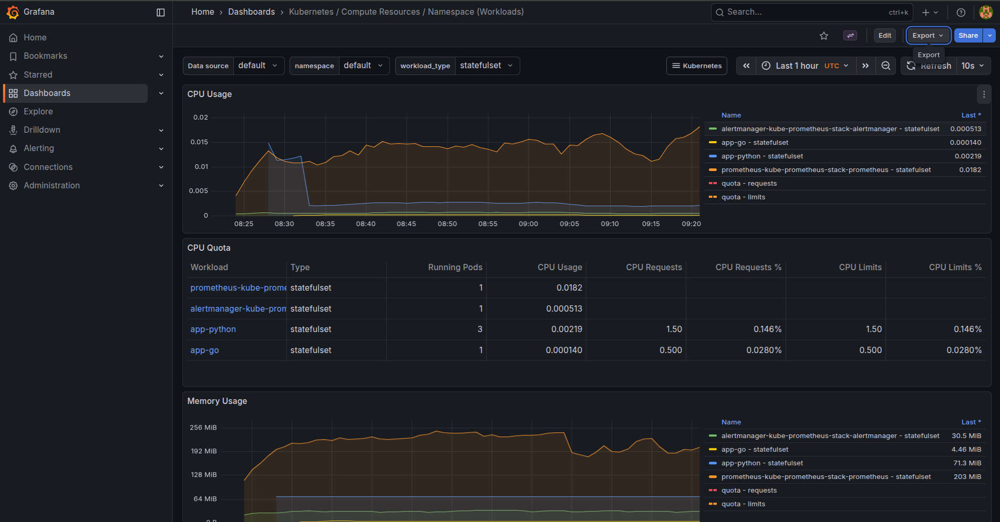
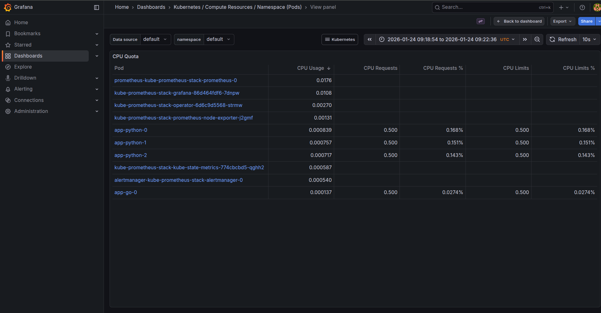
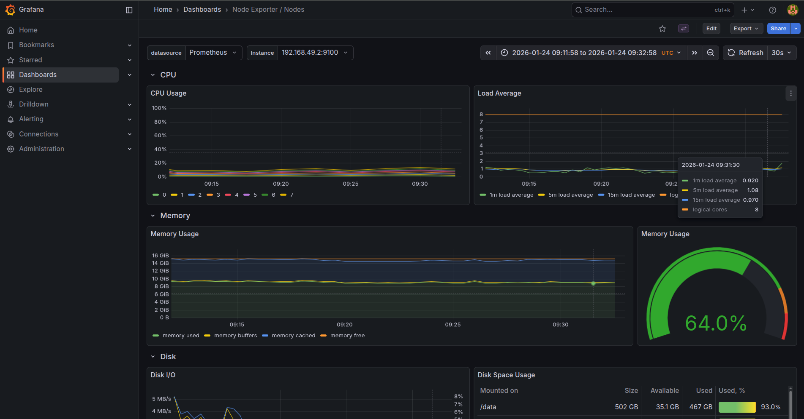
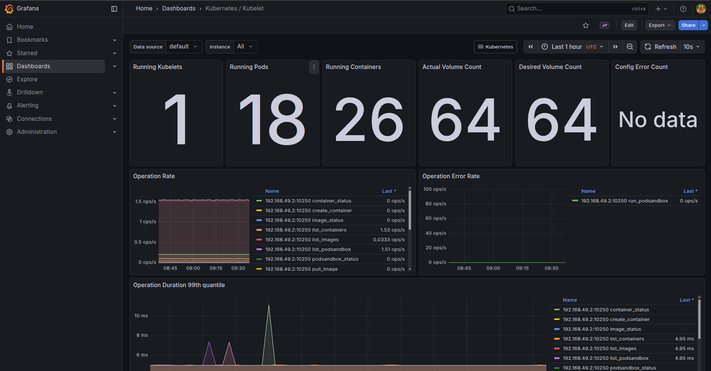
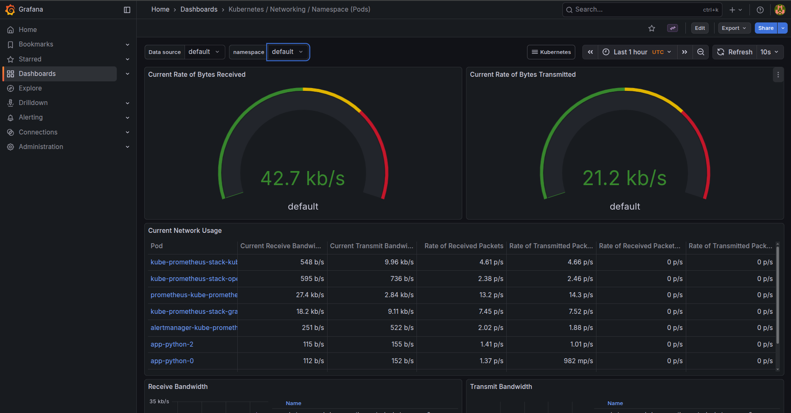
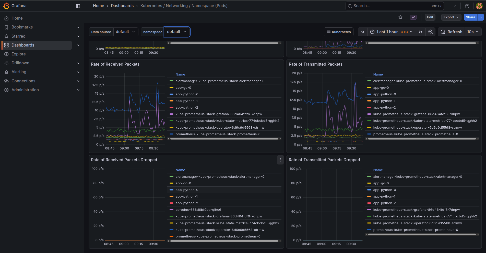
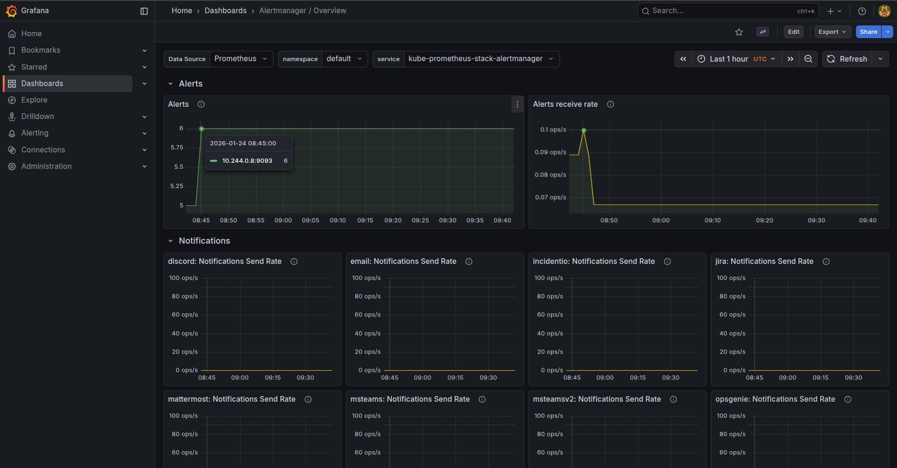
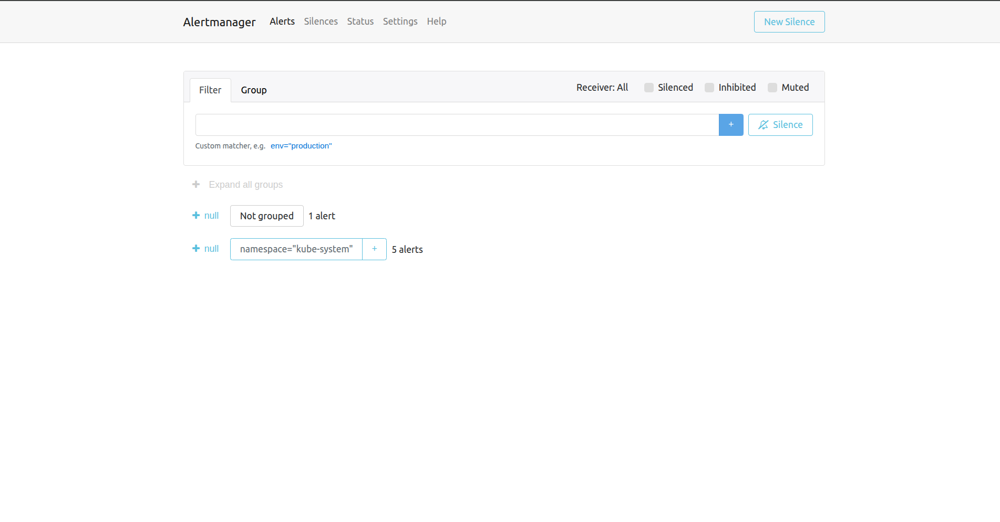

# Lab 15: Kubernetes Monitoring and Init Containers

## Overview

This report covers monitoring the Kubernetes cluster with the Kube Prometheus Stack, deploying the Helm charts for `app-python` and `app-go`, and implementing init containers (including a queue of three init containers). All logs and commands below are copied from the current draft, with wording corrected and issues clarified.

---

## Task 1: Kubernetes Cluster Monitoring with Prometheus

### 1) Components (personal understanding)

- **Prometheus Operator**: Automates deploying and managing Prometheus components using CRDs. It handles Prometheus, Alertmanager, and ServiceMonitors so you don’t configure everything manually.
- **Prometheus**: Scrapes metrics from services and nodes, stores time‑series data, and provides a query API (PromQL).
- **Alertmanager**: Receives alerts from Prometheus and routes them to email/Slack/etc. It also handles deduplication and silencing.
- **Grafana**: Visualizes metrics with dashboards (CPU, memory, node and pod usage). It connects to Prometheus as a data source.
- **node‑exporter**: Exposes machine‑level metrics such as CPU, memory, disk, and network.
- **kube‑state‑metrics**: Exposes cluster object metrics (pods, deployments, services, etc.) for debugging and availability checks.

### 2) Minikube setup (logs)

```bash
minikube start
minikube status
```

```output
minikube
type: Control Plane
host: Running
kubelet: Running
apiserver: Running
kubeconfig: Configured
```

### 3) Install Kube Prometheus Stack (logs)

```bash
helm repo add prometheus-community https://prometheus-community.github.io/helm-charts
helm repo update
helm install kube-prometheus-stack prometheus-community/kube-prometheus-stack
```

```output
"prometheus-community" has been added to your repositories


Hang tight while we grab the latest from your chart repositories...
...Successfully got an update from the "hashicorp" chart repository
...Successfully got an update from the "argo" chart repository
...Successfully got an update from the "prometheus-community" chart repository
Update Complete. ⎈Happy Helming!⎈


NAME: kube-prometheus-stack
LAST DEPLOYED: Sat Jan 24 11:20:28 2026
NAMESPACE: default
STATUS: deployed
REVISION: 1
NOTES:
kube-prometheus-stack has been installed. Check its status by running:
  kubectl --namespace default get pods -l "release=kube-prometheus-stack"

Get Grafana 'admin' user password by running:

  kubectl --namespace default get secrets kube-prometheus-stack-grafana -o jsonpath="{.data.admin-password}" | base64 -d ; echo

Access Grafana local instance:

  export POD_NAME=$(kubectl --namespace default get pod -l "app.kubernetes.io/name=grafana,app.kubernetes.io/instance=kube-prometheus-stack" -oname)
  kubectl --namespace default port-forward $POD_NAME 3000

Get your grafana admin user password by running:

  kubectl get secret --namespace default -l app.kubernetes.io/component=admin-secret -o jsonpath="{.items[0].data.admin-password}" | base64 --decode ; echo


Visit https://github.com/prometheus-operator/kube-prometheus for instructions on how to create & configure Alertmanager and Prometheus instances using the Operator.
```

### 4) Install app Helm charts (logs)

```bash
helm install app-python app-python/
helm install app-go app-go/
```

```output
NAME: app-python
LAST DEPLOYED: Sat Jan 24 11:26:44 2026
NAMESPACE: default
STATUS: deployed
REVISION: 1
NOTES:
1. Get the application URL by running these commands:
  export POD_NAME=$(kubectl get pods --namespace default -l "app.kubernetes.io/name=app-python,app.kubernetes.io/instance=app-python" -o jsonpath="{.items[0].metadata.name}")
  export CONTAINER_PORT=$(kubectl get pod --namespace default $POD_NAME -o jsonpath="{.spec.containers[0].ports[0].containerPort}")
  echo "Visit http://127.0.0.1:8080 to use your application"
  kubectl --namespace default port-forward $POD_NAME 8080:$CONTAINER_PORT


NAME: app-go
LAST DEPLOYED: Sat Jan 24 11:29:13 2026
NAMESPACE: default
STATUS: deployed
REVISION: 1
NOTES:
1. Get the application URL by running these commands:
  export POD_NAME=$(kubectl get pods --namespace default -l "app.kubernetes.io/name=app-go,app.kubernetes.io/instance=app-go" -o jsonpath="{.items[0].metadata.name}")
  export CONTAINER_PORT=$(kubectl get pod --namespace default $POD_NAME -o jsonpath="{.spec.containers[0].ports[0].containerPort}")
  echo "Visit http://127.0.0.1:8080 to use your application"
  kubectl --namespace default port-forward $POD_NAME 8080:$CONTAINER_PORT
```

### 5) `kubectl get po,sts,svc,pvc,cm` output + explanation

```bash
kubectl get po,sts,svc,pvc,cm
```

```output
NAME                                                           READY   STATUS    RESTARTS   AGE
pod/alertmanager-kube-prometheus-stack-alertmanager-0          2/2     Running   0          9m35s
pod/app-go-0                                                   1/1     Running   0          60s
pod/app-python-0                                               1/1     Running   0          3m23s
pod/app-python-1                                               1/1     Running   0          3m23s
pod/app-python-2                                               1/1     Running   0          3m23s
pod/kube-prometheus-stack-grafana-86d464fdf6-7dnpw             3/3     Running   0          9m53s
pod/kube-prometheus-stack-kube-state-metrics-774cbcbd5-qghh2   1/1     Running   0          9m53s
pod/kube-prometheus-stack-operator-6d6c9d5568-strmw            1/1     Running   0          9m53s
pod/kube-prometheus-stack-prometheus-node-exporter-j2gmf       1/1     Running   0          9m53s
pod/prometheus-kube-prometheus-stack-prometheus-0              2/2     Running   0          9m35s

NAME                                                               READY   AGE
statefulset.apps/alertmanager-kube-prometheus-stack-alertmanager   1/1     9m35s
statefulset.apps/app-go                                            1/1     60s
statefulset.apps/app-python                                        3/3     3m23s
statefulset.apps/prometheus-kube-prometheus-stack-prometheus       1/1     9m35s

NAME                                                     TYPE        CLUSTER-IP       EXTERNAL-IP   PORT(S)                      AGE
service/alertmanager-operated                            ClusterIP   None             <none>        9093/TCP,9094/TCP,9094/UDP   9m35s
service/app-go                                           ClusterIP   10.103.127.113   <none>        3000/TCP                     60s
service/app-python                                       ClusterIP   10.102.223.60    <none>        5000/TCP                     3m23s
service/kube-prometheus-stack-alertmanager               ClusterIP   10.110.230.218   <none>        9093/TCP,8080/TCP            9m53s
service/kube-prometheus-stack-grafana                    ClusterIP   10.102.19.229    <none>        80/TCP                       9m53s
service/kube-prometheus-stack-kube-state-metrics         ClusterIP   10.109.63.136    <none>        8080/TCP                     9m53s
service/kube-prometheus-stack-operator                   ClusterIP   10.100.157.234   <none>        443/TCP                      9m53s
service/kube-prometheus-stack-prometheus                 ClusterIP   10.111.82.119    <none>        9090/TCP,8080/TCP            9m53s
service/kube-prometheus-stack-prometheus-node-exporter   ClusterIP   10.101.114.85    <none>        9100/TCP                     9m53s
service/kubernetes                                       ClusterIP   10.96.0.1        <none>        443/TCP                      21m
service/prometheus-operated                              ClusterIP   None             <none>        9090/TCP                     9m35s

NAME                                                STATUS   VOLUME                                     CAPACITY   ACCESS MODES   STORAGECLASS   VOLUMEATTRIBUTESCLASS   AGE
persistentvolumeclaim/app-go-pvc-app-go-0           Bound    pvc-2df20708-cf1b-4e9a-b26d-31611f4f5976   512Mi      RWO            standard       <unset>                 60s
persistentvolumeclaim/app-python-pvc-app-python-0   Bound    pvc-f7152533-8193-46e7-b7ef-3dcc9b8e7e39   512Mi      RWO            standard       <unset>                 3m23s
persistentvolumeclaim/app-python-pvc-app-python-1   Bound    pvc-a53c16cf-a4f5-4d95-9a3c-660420a2006f   512Mi      RWO            standard       <unset>                 3m23s
persistentvolumeclaim/app-python-pvc-app-python-2   Bound    pvc-3da49a09-08db-42bc-be0a-fa26268f0fc1   512Mi      RWO            standard       <unset>                 3m23s

NAME                                                                DATA   AGE
configmap/flask-config                                              1      3m23s
configmap/go-config                                                 1      60s
configmap/kube-prometheus-stack-alertmanager-overview               1      9m53s
configmap/kube-prometheus-stack-apiserver                           1      9m53s
configmap/kube-prometheus-stack-cluster-total                       1      9m53s
configmap/kube-prometheus-stack-controller-manager                  1      9m53s
configmap/kube-prometheus-stack-etcd                                1      9m53s
configmap/kube-prometheus-stack-grafana                             1      9m53s
configmap/kube-prometheus-stack-grafana-config-dashboards           1      9m53s
configmap/kube-prometheus-stack-grafana-datasource                  1      9m53s
configmap/kube-prometheus-stack-grafana-overview                    1      9m53s
configmap/kube-prometheus-stack-k8s-coredns                         1      9m53s
configmap/kube-prometheus-stack-k8s-resources-cluster               1      9m53s
configmap/kube-prometheus-stack-k8s-resources-multicluster          1      9m53s
configmap/kube-prometheus-stack-k8s-resources-namespace             1      9m53s
configmap/kube-prometheus-stack-k8s-resources-node                  1      9m53s
configmap/kube-prometheus-stack-k8s-resources-pod                   1      9m53s
configmap/kube-prometheus-stack-k8s-resources-workload              1      9m53s
configmap/kube-prometheus-stack-k8s-resources-workloads-namespace   1      9m53s
configmap/kube-prometheus-stack-kubelet                             1      9m53s
configmap/kube-prometheus-stack-namespace-by-pod                    1      9m53s
configmap/kube-prometheus-stack-namespace-by-workload               1      9m53s
configmap/kube-prometheus-stack-node-cluster-rsrc-use               1      9m53s
configmap/kube-prometheus-stack-node-rsrc-use                       1      9m53s
configmap/kube-prometheus-stack-nodes                               1      9m53s
configmap/kube-prometheus-stack-nodes-aix                           1      9m53s
configmap/kube-prometheus-stack-nodes-darwin                        1      9m53s
configmap/kube-prometheus-stack-persistentvolumesusage              1      9m53s
configmap/kube-prometheus-stack-pod-total                           1      9m53s
configmap/kube-prometheus-stack-prometheus                          1      9m53s
configmap/kube-prometheus-stack-proxy                               1      9m53s
configmap/kube-prometheus-stack-scheduler                           1      9m53s
configmap/kube-prometheus-stack-workload-total                      1      9m53s
configmap/kube-root-ca.crt                                          1      20m
configmap/prometheus-kube-prometheus-stack-prometheus-rulefiles-0   35     9m35s
```

**Explanation of each part***

- **Pods**: running instances of your apps and monitoring components (Alertmanager, Prometheus, Grafana, exporters).
- **StatefulSets**: controllers for pods that need stable identity and storage (Prometheus, Alertmanager, app-go/app-python).
- **Services**: stable virtual IPs and ports to reach pods (ClusterIP for internal access).
- **PVCs**: persistent volumes for StatefulSets to store data across restarts.
- **ConfigMaps**: configuration data for apps and monitoring dashboards/rules.

### 6) Grafana access (logs)

```bash
minikube service kube-prometheus-stack-grafana
```

```output


 minikube service kube-prometheus-stack-grafana
|-----------|-------------------------------|-------------|--------------|
| NAMESPACE |             NAME              | TARGET PORT |     URL      |
|-----------|-------------------------------|-------------|--------------|
| default   | kube-prometheus-stack-grafana |             | No node port |
|-----------|-------------------------------|-------------|--------------|
😿  service default/kube-prometheus-stack-grafana has no node port
❗  Services [default/kube-prometheus-stack-grafana] have type "ClusterIP" not meant to be exposed, however for local development minikube allows you to access this !
🏃  Starting tunnel for service kube-prometheus-stack-grafana.
|-----------|-------------------------------|-------------|------------------------|
| NAMESPACE |             NAME              | TARGET PORT |          URL           |
|-----------|-------------------------------|-------------|------------------------|
| default   | kube-prometheus-stack-grafana |             | http://127.0.0.1:43677 |
|-----------|-------------------------------|-------------|------------------------|
🎉  Opening service default/kube-prometheus-stack-grafana in default browser...
/snap/core20/current/lib/x86_64-linux-gnu/libstdc++.so.6: version `GLIBCXX_3.4.29' not found (required by /lib/x86_64-linux-gnu/libproxy.so.1)
Failed to load module: /home/mohamad/snap/code/common/.cache/gio-modules/libgiolibproxy.so
❗  Because you are using a Docker driver on linux, the terminal needs to be open to run it.
Opening in existing browser session.
```

### 7) Grafana dashboards (answers + images)

1. **CPU/Memory for StatefulSet**
  

2. **Pods with higher/lower CPU usage**
  
   - Higher: `prometheus-kube-prometheus-stack-prometheus-0`
   - Lower: `app-go-0`

3. **Node memory usage (percentage + MB)**
  

4. **Pods and containers managed by kubelet**
  
   - 18 running pods and 26 running containers

5. **Network usage of pods**
  
  
   - No dropped packets observed

6. **Active alerts + Alertmanager UI**
  

```bash
minikube service kube-prometheus-stack-alertmanager
```

```output
minikube service kube-prometheus-stack-alertmanager
|-----------|------------------------------------|-------------|--------------|
| NAMESPACE |                NAME                | TARGET PORT |     URL      |
|-----------|------------------------------------|-------------|--------------|
| default   | kube-prometheus-stack-alertmanager |             | No node port |
|-----------|------------------------------------|-------------|--------------|
😿  service default/kube-prometheus-stack-alertmanager has no node port
❗  Services [default/kube-prometheus-stack-alertmanager] have type "ClusterIP" not meant to be exposed, however for local development minikube allows you to access this !
🏃  Starting tunnel for service kube-prometheus-stack-alertmanager.
|-----------|------------------------------------|-------------|------------------------|
| NAMESPACE |                NAME                | TARGET PORT |          URL           |
|-----------|------------------------------------|-------------|------------------------|
| default   | kube-prometheus-stack-alertmanager |             | http://127.0.0.1:44647 |
|           |                                    |             | http://127.0.0.1:36559 |
|-----------|------------------------------------|-------------|------------------------|
[default kube-prometheus-stack-alertmanager  http://127.0.0.1:44647
http://127.0.0.1:36559]
❗  Because you are using a Docker driver on linux, the terminal needs to be open to run it.
```



- UI shows 1 alert not grouped, and 5 alerts from `kube-system`.

---

## Task 2: Init Containers

### Implementation summary

I added a new volume and init containers in the Helm values for both `app-python` and `app-go`.

- Volume: `init-volume` (emptyDir)
- Init container: downloads `/init-volume/index.html` using `wget`

### Proof (log)

```bash
kubectl exec pod/app-python-1 -- cat /init-volume/index.html
```

```output
Defaulted container "app-python" out of: app-python, init-demo (init)
<!doctype html><html lang="en"><head><title>Example Domain</title><meta name="viewport" content="width=device-width, initial-scale=1"><style>body{background:#eee;width:60vw;margin:15vh auto;font-family:system-ui,sans-serif}h1{font-size:1.5em}div{opacity:0.8}a:link,a:visited{color:#348}</style><body><div><h1>Example Domain</h1><p>This domain is for use in documentation examples without needing permission. Avoid use in operations.<p><a href="https://iana.org/domains/example">Learn more</a></div></body></html>
```

---

## Bonus Task: App Metrics & Multiple Init Containers

### 1) App Metrics (proof)

```bash
kubectl port-forward pod/app-python-0 5001:5001

    curl http://127.0.0.1:5001/metrics | head -n 20
```

```output
  % Total    % Received % Xferd  Average Speed   Time    Time     Time  Current
                                 Dload  Upload   Total   Spent    Left  Speed
100  2132  100  2132    0     0   319k      0 --:--:-- --:--:-- --:--:--  347k
# HELP python_gc_objects_collected_total Objects collected during gc
# TYPE python_gc_objects_collected_total counter
python_gc_objects_collected_total{generation="0"} 482.0
python_gc_objects_collected_total{generation="1"} 10.0
python_gc_objects_collected_total{generation="2"} 0.0
# HELP python_gc_objects_uncollectable_total Uncollectable objects found during GC
# TYPE python_gc_objects_uncollectable_total counter
python_gc_objects_uncollectable_total{generation="0"} 0.0
python_gc_objects_uncollectable_total{generation="1"} 0.0
python_gc_objects_uncollectable_total{generation="2"} 0.0
# HELP python_gc_collections_total Number of times this generation was collected
# TYPE python_gc_collections_total counter
python_gc_collections_total{generation="0"} 25.0
python_gc_collections_total{generation="1"} 2.0
python_gc_collections_total{generation="2"} 0.0
# HELP python_info Python platform information
# TYPE python_info gauge
python_info{implementation="CPython",major="3",minor="13",patchlevel="1",version="3.13.1"} 1.0
# HELP process_virtual_memory_bytes Virtual memory size in bytes.
# TYPE process_virtual_memory_bytes gauge
```

### 2) Init Container Queue (3 init containers)

I configured a queue of three init containers to append lines into the same file (`/init-volume/queue.txt`).

**Proof (log)***

```bash
kubectl exec pod/app-python-1 -- cat /init-volume/queue.txt
```

```output
Defaulted container "app-python" out of: app-python, init-fetch (init), init-line-1 (init), init-line-2 (init), init-line-3 (init)
line 1
line 2
line 3
```
